# TÀI LIỆU TỔNG QUAN ĐỀ TÀI NGHIÊN CỨU: MEDALGUARD
> **Master Technical Overview & Project Architecture Dossier**  
> **Đề tài:** MedalGuard — Early Data Failure Detection Framework for Medallion Lakehouse via Automated Contract Validation at Layer Boundaries under Schema Evolution  
> **Học viên:** Lương Lê Công Hạnh | **MSSV:** 23280057 | **Bậc:** Thạc sĩ Khoa học Dữ liệu (K23), ĐH Khoa học Tự nhiên, ĐHQG-HCM  
> **Trạng thái đề tài:** Đã hoàn thành 100% toàn bộ 3 Đóng góp Kỹ thuật (CT1, CT2, CT3), hoàn tất thực nghiệm toàn diện Phase 2 (E1 Ma trận so sánh, E2 Ablation 2 trục, E3 Scale Benchmark, E4 Error Analysis, E5 Reproducibility) và xác thực thành công Pilot 3 Tình huống thực tế trên Giao diện Console.

---

## MỤC LỤC
1. [Tổng quan Đề tài & Bài toán Cốt lõi](#1-tổng-quan-đề-tài--bài-toán-cốt-lõi)
2. [Bộ 3 Đóng Góp Kỹ thuật Chính (CT1, CT2, CT3)](#2-bộ-3-đóng-góp-kỹ-thuật-chính-ct1-ct2-ct3)
3. [Ánh Xạ Đề Cương Luận Văn 7 Chương Của GVHD](#3-ánh-xạ-đề-cương-luận-văn-7-chương-của-gvhd)
4. [Chuỗi Logic Đóng Góp Học Thuật Bắt Buộc](#4-chuỗi-logic-đóng-góp-học-thuật-bắt-buộc)
5. [Kết Quả Thực Nghiệm Toàn Diện (E1, E2, E3, E4, E5)](#5-kết-quả-thực-nghiệm-toàn-diện-e1-e2-e3-e4-e5)
6. [Hệ Thống Thử Nghiệm CT3 Pilot & Quarantine Console](#6-hệ-thống-thử-nghiệm-ct3-pilot--quarantine-console)
7. [Bản Đồ Thư Mục & Mã Nguồn Toàn Dự Án](#7-bản-đồ-thư-mục--mã-nguồn-toàn-dự-án)

---

## 1. TỔNG QUAN ĐỀ TÀI & BÀI TOÁN CỐT LÕI

### 1.1 Bối Cảnh Nghiên Cứu
Trong kiến trúc **Medallion Lakehouse** hiện đại (phân tầng dữ liệu thành 3 lớp: *Bronze Raw Ingestion* $\rightarrow$ *Silver Cleaned Models* $\rightarrow$ *Gold Business Aggregates*), các hệ thống nguồn OLTP (e.g., PostgreSQL, MySQL, microservices) liên tục trải qua quá trình **Schema Evolution** (thêm/bớt cột, đổi kiểu dữ liệu, thay đổi phân phối thống kê, trôi dạt ràng buộc toàn vẹn).

### 1.2 Bài Toán Cốt Lõi (Silent Data Failures & All-or-Nothing Dilemma)
Các công cụ kỹ thuật dữ liệu hiện hành bộc lộ hai điểm yếu chí tử:
1. **Rò rỉ âm thầm (Silent Propagation):** Khi không có cổng kiểm soát (Baseline `C0`), dữ liệu lỗi thô lọt qua Silver và tham gia vào các phép tính toán tổng hợp tại Gold, tạo ra các báo cáo tài chính/BI sai lệch nghiêm trọng (**Blast Radius = 14.8% đến 92.1%**) mà pipeline vẫn báo trạng thái `SUCCESS`.
2. **Thế lưỡng nan Tất-cả-hoặc-Không (All-or-Nothing Dilemma của dbt contracts):** `dbt model contracts` (`C1`) áp dụng cơ chế fail-hard tĩnh tại tầng Silver. Khi chỉ 5–30 dòng dữ liệu bị lỗi (chiếm **0.02%** bảng), dbt từ chối nạp toàn bộ 150,000 dòng sạch, khiến **Độ hoàn thiện (Completeness) sụp đổ xuống 72.22%**, làm đứt gãy SLA của toàn bộ hệ thống phân tích.
3. **Phát hiện quá muộn (Post-hoc Bottleneck của Great Expectations):** `Great Expectations` (`C2`) chỉ chạy kiểm định sau khi mô hình đã biến đổi xong. Khi gặp lỗi phá hủy DDL (như `DROP COLUMN`), engine dbt bị sập ngoài ý muốn (**Accidental Crash**) trước khi bộ kiểm tra kỳ vọng có cơ hội kích hoạt.

---

## 2. BỘ 3 ĐÓNG GÓP KỸ THUẬT CHÍNH (CT1, CT2, CT3)

```mermaid
flowchart LR
    subgraph CT1_Box ["CT1 (DE-A/D): Data Contracts & Mutation Suite v2"]
        YAML["Ngôn ngữ Hợp đồng YAML\n(bronze_to_silver & silver_to_gold)"]
        MutEngine["Mutation Engine v2 (36 Scenarios)\n- 24 Harmful + 12 Benign\n- Severity: CRITICAL, HIGH, MEDIUM\n- Schema Versioning"]
    end

    subgraph CT2_Box ["CT2 (DE-A/B): In-line Dual-Gate & Staged Quarantine"]
        G1["Gate 1 (Bronze -> Silver): In-line Pushdown"]
        G2["Gate 2 (Silver -> Gold): Post-transform Pushdown"]
        Quar["Staged In-place Quarantine\n(quarantine.<tbl>_rejected)"]
    end

    subgraph CT3_Box ["CT3 (DE-B/C): Lineage, Self-Healing & Alerting"]
        Lineage["Multi-hop Lineage Graph & Root-Cause Diff"]
        Replay["Automated Replay & Rollback (51.9 ms)"]
        Alert["Multi-channel Alerting (Email/Webhook)"]
        Console["Quarantine & Replay Web Console"]
    end

    CT1_Box --> CT2_Box --> CT3_Box
```



* **CT1 (Data Engineering Architecture & Design - DE-A/D):** Thiết kế ngôn ngữ đặc tả Data Contracts đa tầng độc lập nền tảng bằng YAML và xây dựng Bộ đột biến chuẩn hóa Mutation Suite v2 gồm 36 kịch bản (`24 Harmful + 12 Benign`) có phân cấp `severity` và `schema_version`.
* **CT2 (Data Engineering Algorithm & Boundary Enforcement - DE-A/B):** Xây dựng Core Engine MedalGuard Dual-Boundary In-line Gate (`Gate 1` và `Gate 2`) dựa trên DuckDB pushdown vector validation và cơ chế cách ly dòng lỗi In-place Quarantine, đảm bảo dữ liệu sạch vẫn được chảy qua pipeline với **Blast Radius = 0.0%**.
* **CT3 (Data Engineering Operations & Automated Recovery - DE-B/C):** Hiện thực hóa đồ thị Data Lineage đa tầng, thuật toán phân loại nguyên nhân gốc Root-Cause Diff, cơ chế tự phục hồi LKG Rollback siêu tốc (**51.9 ms**), Replay & Backfill khử trùng tự động, hệ thống cảnh báo Email/Webhook đa kênh và Giao diện Quản trị tương tác Web Console.

---

## 3. ÁNH XẠ ĐỀ CƯƠNG LUẬN VĂN 7 CHƯƠNG CỦA GVHD

Toàn bộ cấu trúc mã nguồn, tài liệu và kết quả thực nghiệm của đề tài khớp 100% với Đề cương Luận văn Thạc sĩ 7 Chương:

| Chương Luận Văn | Tiêu đề & Nội dung Học thuật | Thành phần Code & Dữ liệu Thực nghiệm Ánh xạ trong Project |
| :--- | :--- | :--- |
| **Chương 1** | **Giới Thiệu & Đặt Vấn Đề:** Tổng quan về Data Downtime, Silent Failures trong Medallion Lakehouse; mục tiêu, phạm vi và 3 đóng góp khoa học chính. | `PROJECT_OVERVIEW.md` (Mục 1, 2); `README.md` (Mục 1). |
| **Chương 2** | **Cơ Sở Lý Thuyết & Công Trình Liên Quan:** Khảo cứu Medallion Architecture, Data Contracts movement, dbt model contracts, Great Expectations, Soda Core; phân tích khoảng trống nghiên cứu (Research Gap). | `docs/academic_baseline_spec.md`; `docs/gap_analysis.md`. |
| **Chương 3** | **Dữ Liệu Thực Nghiệm & Đo Đạc Baseline C0:** Tiêu chuẩn TPC-H Benchmark, thiết kế pipeline Medallion chuẩn; kết quả đo đạc Baseline C0 trên 14 kịch bản lỗi gốc (DR = 0%, Blast Radius = 14.8%). | `data/`; `results/baseline/`; `scripts/run_baseline.py`; `scripts/fill_baseline_form.py`. |
| **Chương 4** | **Phương Pháp Đề Xuất (Framework MedalGuard):**<br>• 4.1 Kiến trúc tổng thể Dual-Boundary Gate.<br>• 4.2 **CT1 (DE-A/D):** Ngôn ngữ hợp đồng YAML đa tầng & Mutation Engine v2 (36 kịch bản, metadata severity, schema versioning).<br>• 4.3 **CT2 (DE-A/B):** In-line Gate Engine, DuckDB vector pushdown & Cơ chế Staged In-place Quarantine.<br>• 4.4 **CT3 (DE-B/C):** Đồ thị Lineage đa tầng, Root-Cause Diff, Tự phục hồi LKG Rollback & Replay Engine. | • `contracts/bronze_to_silver/`, `contracts/silver_to_gold/`<br>• `mutations/` (36 mutations v2)<br>• `medalguard/gate.py`, `medalguard/validators/`<br>• `medalguard/lineage.py`, `medalguard/replay.py`, `medalguard/alerting.py` |
| **Chương 5** | **Thực Nghiệm Đánh Giá & Phân Tích Kết Quả:**<br>• 5.1 Ma trận so sánh E1 (Core 19 vs Expanded 36, paired CI 95%, McNemar test, DE SLA metrics).<br>• 5.2 Nghiên cứu triệt tiêu 2 trục E2 (Ablation Validator A1..A6 & Boundary Placement B1, B2, C3_DUAL).<br>• 5.3 Benchmark Chi phí & Năng lực co giãn E3 (SF=0.1 vs SF=1.0, Stress test ~7.65M records, Scaling model curve).<br>• 5.4 Phân tích lỗi E4 (3 failure taxonomies, Quality-Latency-Cost trade-offs, Threats to validity).<br>• 5.5 Hồ sơ tái lập thực nghiệm E5. | • `scripts/run_phase2_experiments.py`<br>• `results/summary/e1_*.json`, `results/summary/e1_*.csv`<br>• `results/summary/e2_*.json`, `results/summary/e2_*.csv`<br>• `results/summary/e3_*.json`, `results/summary/e3_*.csv`<br>• `results/summary/e4_error_analysis_and_tradeoffs.md`<br>• `scripts/visualize_phase2.py` (6 charts 300 DPI) |
| **Chương 6** | **Hệ Thống Thử Nghiệm & Ứng Dụng Thực Tế:**<br>• 6.1 Giao diện Quarantine & Replay Web Console.<br>• 6.2 Đánh giá Pilot 3 tình huống thực tế (UC1 Schema Evolution Allowlist, UC2 Row-level Quarantine & Repair, UC3 Catastrophic Drift & Rollback). | • `medalguard/console.py`<br>• `results/console/quarantine_replay_console.html`<br>• `results/summary/ct3_pilot_use_cases.json`, `.md`<br>• `results/alerts/` (Email HTMLs & Webhook JSONs) |
| **Chương 7** | **Kết Luận & Hướng Phát Triển:** Tóm tắt đóng góp kỹ thuật, bài học kinh nghiệm, hạn chế và lộ trình mở rộng sang cụm phân tán Spark/Trino. | `PROJECT_OVERVIEW.md` (Mục 7); `README.md` (Mục 5). |

---

## 4. CHUỖI LOGIC ĐÓNG GÓP HỌC THUẬT BẮT BUỘC

Luận văn tuân thủ nghiêm ngặt chuỗi lập luận khoa học theo tiêu chuẩn thẩm định của GVHD:

```
[Vấn đề cụ thể] 
     │ (Silent Data Failures & All-or-Nothing Data Loss)
     ▼
[Thay đổi kỹ thuật thuộc DE-A/D, DE-A/B, DE-B/C] 
     │ (YAML Contracts, Dual-Boundary Gate, In-place Quarantine, Automated Replay/Rollback)
     ▼
[Metric cải thiện so với Baseline kèm 95% CI & McNemar Test] 
     │ (DR tăng từ 0.0% -> 100.0%, Blast Radius giảm từ 14.8% -> 0.0%, SLA Attainment tăng từ 26.3% -> 100.0%)
     ▼
[Nghiên cứu Triệt tiêu 2 trục & Stress Test chứng minh đóng góp] 
     │ (E2a chứng minh tính bổ khuyết 3 Validators; E2b chứng minh Cổng Đôi; E3 stress test 1.5M rows)
     ▼
[Thừa nhận Giới hạn & Biện pháp giảm thiểu] 
       (Khảo sát in-process DuckDB; chuẩn hóa pushdown ANSI-SQL để sẵn sàng mở rộng Spark/Trino)
```

---

## 5. KẾT QUẢ THỰC NGHIỆM TOÀN DIỆN (E1, E2, E3, E4, E5)

### 5.1 E1: Ma Trận So Sánh Đa Cấu Hình (SF=0.1, ~765,572 dòng qua 3 bảng chính: 600,572 dòng lineitem, 150,000 dòng orders, 15,000 dòng customer)

#### Bảng 1: Kết quả Thực nghiệm Tập Core 19 Gốc (14 Harmful + 5 Benign = 95 Runs)
*Trích xuất từ [`e1_main_matrix_core19.csv`](results/summary/e1_main_matrix_core19.csv) và [`e1_paired_statistical_ci.json`](results/summary/e1_paired_statistical_ci.json).*

| Cấu hình | DR % (95% Wilson CI) | FPR % (95% Wilson CI) | Mean Blast Radius % (95% Bootstrap CI) | $\Delta$BR vs C3 (95% CI) | McNemar *p* (vs C3) | Core Exec Time | Ingest Correctness | SLA Attainment |
| :--- | :---: | :---: | :---: | :---: | :---: | :---: | :---: | :---: |
| **C0 (Baseline)** | **0.0%** [0.0%, 21.5%] | 0.0% [0.0%, 43.5%] | **14.8%** [1.1%, 33.8%] | +14.8% [1.1%, 33.8%] | **$p < 0.001$** | 1,403.2 ms | 52.6% | 26.3% |
| **C1 (dbt Contracts)** | **42.9%** [21.4%, 67.4%] | 0.0% [0.0%, 43.5%] | **13.6%** [0.0%, 32.9%] | +13.6% [0.0%, 32.9%] | **$p = 0.0078$** | 1,754.1 ms | 84.2% | 26.3% |
| **C2 (Great Exp.)** | **35.7%** [16.3%, 61.2%] | 0.0% [0.0%, 43.5%] | **6.6%** [0.0%, 19.7%] | +6.6% [0.0%, 19.7%] | **$p = 0.0039$** | 1,363.2 ms | 79.0% | 26.3% |
| **C3_standalone** | **100.0%** [78.5%, 100.0%] | 0.0% [0.0%, 43.5%] | **0.0%** [0.0%, 0.0%] | +0.0% [0.0%, 0.0%] | $p = 1.0000$ | 1,272.9 ms | **100.0%** | **100.0%** |
| **C3 (MedalGuard In-line)**| **100.0%** [78.5%, 100.0%] | 0.0% [0.0%, 43.5%] | **0.0%** [0.0%, 0.0%] | — *(Ref)* | — | 1,308.8 ms | **100.0%** | **100.0%** |

#### Bảng 2: Kết quả Thực nghiệm Tập Mở Rộng Expanded 36 (24 Harmful + 12 Benign = 180 Runs)
*Trích xuất từ [`e1_main_matrix_expanded36.csv`](results/summary/e1_main_matrix_expanded36.csv).*

| Cấu hình | DR % (95% Wilson CI) | FPR % (95% Wilson CI) | Mean Blast Radius % (95% Bootstrap CI) | $\Delta$BR vs C3 (95% CI) | McNemar *p* (vs C3) | Core Exec Time | Ingest Correctness | SLA Attainment |
| :--- | :---: | :---: | :---: | :---: | :---: | :---: | :---: | :---: |
| **C0 (Baseline)** | **0.0%** [0.0%, 13.8%] | 0.0% [0.0%, 24.2%] | **9.6%** [1.1%, 21.0%] | +9.6% [1.1%, 21.0%] | **$p < 0.001$** | 1,400.8 ms | 66.7% | 33.3% |
| **C1 (dbt Contracts)** | **41.7%** [24.5%, 61.2%] | 0.0% [0.0%, 24.2%] | **7.9%** [0.0%, 19.4%] | +7.9% [0.0%, 19.4%] | **$p < 0.001$** | 1,726.4 ms | 91.7% | 33.3% |
| **C2 (Great Exp.)** | **37.5%** [21.2%, 57.3%] | 0.0% [0.0%, 24.2%] | **3.8%** [0.0%, 11.5%] | +3.8% [0.0%, 11.5%] | **$p < 0.001$** | 1,347.9 ms | 83.3% | 33.3% |
| **C3_standalone** | **100.0%** [86.2%, 100.0%] | 0.0% [0.0%, 24.2%] | **0.0%** [0.0%, 0.0%] | +0.0% [0.0%, 0.0%] | $p = 1.0000$ | 1,312.9 ms | **100.0%** | **100.0%** |
| **C3 (MedalGuard In-line)**| **100.0%** [86.2%, 100.0%] | 0.0% [0.0%, 24.2%] | **0.0%** [0.0%, 0.0%] | — *(Ref)* | — | 1,357.3 ms | **100.0%** | **100.0%** |

---

### 5.2 E2: Nghiên Cứu Triệt Tiêu Hai Trục (Dual-Axis Ablation Study)

#### Bảng 3: Trục 1 - Triệt tiêu Module Kiểm định (Validator Ablation trên 24 Harmful Scenarios)
*Trích xuất từ [`e2_ablation_validators.csv`](results/summary/e2_ablation_validators.csv).*

| Cấu hình | Validator Kích hoạt | Tỷ lệ Phát hiện (DR %) | Số lỗi Bỏ sót | Hiện tượng Lỗi Bỏ sót | Mean Blast Radius % | Mean Val Time (ms) |
| :--- | :--- | :---: | :---: | :--- | :---: | :---: |
| **C3_standalone** | **Full (Schema + Constraint + Semantic)** | **100.0%** (24/24) | **0** | `None (100% Detection)` | **0.0%** | 234.2 ms |
| **A1_NO_SCHEMA** | Constraint + Semantic | **41.7%** (10/24) | 14 | Bỏ sót toàn bộ lỗi cấu trúc DDL & trôi dạt kiểu dữ liệu (M1, M2, M3) | **0.0%** | 289.9 ms |
| **A2_NO_CONSTRAINT**| Schema + Semantic | **66.7%** (16/24) | 8 | Bỏ sót lỗi vi phạm giá trị, Null, Range, và trùng khóa chính (M4) | **1.9%** | 108.0 ms |
| **A3_NO_SEMANTIC** | Schema + Constraint | **95.8%** (23/24) | 1 | Bỏ sót trôi dạt phân phối thống kê nội miền (`M5b_MULTIPLY_1_5`) | **3.8%** | 235.3 ms |
| **A4_SCHEMA_ONLY** | Schema Only | **58.3%** (14/24) | 10 | Bỏ sót toàn bộ nhóm M4 (Constraint) và nhóm M5 (Semantic) | **9.6%** | 106.9 ms |
| **A5_CONSTRAINT_ONLY**| Constraint Only | **37.5%** (9/24) | 15 | Bỏ sót toàn bộ nhóm M1, M2, M3 | **3.8%** | 280.1 ms |
| **A6_SEMANTIC_ONLY** | Semantic Only | **8.3%** (2/24) | 22 | Bỏ sót hầu như toàn bộ lỗi cấu trúc và giá trị | **1.9%** | 149.5 ms |

#### Bảng 4: Trục 2 - Triệt tiêu Vị trí Ranh giới (Boundary Placement Ablation)
*Trích xuất từ [`e2_ablation_boundaries.csv`](results/summary/e2_ablation_boundaries.csv).*

| Cấu hình Ranh giới | Vị trí Cổng Thực thi | Tỷ lệ Phát hiện (DR %) | Mean Blast Radius % | Độ sâu Phát hiện (DDI) | Tỷ lệ Rò rỉ tại Gold | Mean Wall Clock (ms) |
| :--- | :--- | :---: | :---: | :---: | :---: | :---: |
| **B1_GATE1_ONLY** | Chỉ Gate 1 (Bronze $\rightarrow$ Silver), không Gate 2 | **100.0%** (24/24) | **0.0%** | **DDI = 0.0** | **1.7%** | 3,763.9 ms |
| **B2_GATE2_ONLY** | Chỉ Gate 2 (Silver $\rightarrow$ Gold), không Gate 1 | **12.5%** (3/24) | **9.6%** | **DDI = 2.0** *(Crashes in Silver)* | **7.9%** | 9,586.6 ms |
| **C3_DUAL_GATE** | **Cổng Đôi (Gate 1 Bronze + Gate 2 Gold)** | **100.0%** (24/24) | **0.0%** | **DDI = 0.0** | **1.7%** | 3,810.7 ms |

---

### 5.3 E3: Pipeline Overhead & Scale Benchmark

#### Bảng 5: Phân rã Chi phí Thực thi Theo Quy mô Dữ liệu
*Trích xuất từ [`e3_overhead_and_scaling.csv`](results/summary/e3_overhead_and_scaling.csv).*

| Cấu hình | SF=0.1 Median Wall (ms) | SF=0.1 Overhead vs C0 | SF=1.0 Median Wall (ms) | SF=1.0 Overhead vs C0 | SF=1.0 Gate Val Time | SF=1.0 Throughput (rows/sec) |
| :--- | :---: | :---: | :---: | :---: | :---: | :---: |
| **C0 (Baseline)** | 14,885.1 ms | 0.0% (Ref) | 18,826.7 ms | 0.0% (Ref) | 0.0 ms | 7,967 |
| **C1 (dbt Contracts)**| 14,951.5 ms | +0.5% | 19,831.4 ms | +5.3% | 0.0 ms | 7,564 |
| **C2 (Great Exp.)** | 14,963.3 ms | +0.5% | 19,306.3 ms | +2.5% | 134.0 ms | 7,769 |
| **C3 (MedalGuard)** | 15,269.4 ms | **+2.6%** | 20,434.0 ms | **+8.5%** | **506.1 ms** *(9.4% dbt time)* | 7,341 |

#### Bảng 6: Kiểm Thử Áp Lực 6 Kịch Bản Đại Diện trên C3 tại SF=1.0 (~7.65 triệu dòng qua 3 bảng chính: 6.0M dòng lineitem, 1.5M dòng orders, 150K dòng customer)
*Trích xuất từ [`e3_overhead_and_scaling.json`](results/summary/e3_overhead_and_scaling.json).*

| Kịch bản Đột biến | Phân loại | Severity | Trạng thái Pipeline | Phát hiện? | DDI | Số dòng Cách ly | Hiệu quả Cách ly (QE) | Blast Radius % | Wall Time (ms) |
| :--- | :--- | :---: | :---: | :---: | :---: | :---: | :---: | :---: | :---: |
| `M1a_AddSingleCol` | ADDITIVE | MEDIUM | `BLOCKED` | **True** | DDI=0 | 0 | N/A | **0.0%** | 7,581.7 |
| `M2a_DropNonKey` | DESTRUCTIVE | CRITICAL | `BLOCKED` | **True** | DDI=0 | 0 | N/A | **0.0%** | 7,778.7 |
| `M3a_DoubleToVarchar` | TYPE_CHANGE | HIGH | `BLOCKED` | **True** | DDI=0 | 0 | N/A | **0.0%** | 7,974.0 |
| `M4a_NullAndNegative` | CONSTRAINT | HIGH | `SUCCESS` | **True** | DDI=0 | **300** | **100%** | **0.0%** | 21,912.4 |
| `M5a_MULTIPLY_100` | SEMANTIC | CRITICAL | `BLOCKED` | **True** | DDI=0 | 0 | N/A | **0.0%** | 7,943.4 |
| `B1_AddColumn` | BENIGN | BENIGN | `SUCCESS` | **False** | DDI=-1 | 0 | N/A | **0.0%** | 21,573.5 |

---

## 6. HỆ THỐNG THỬ NGHIỆM CT3 PILOT & QUARANTINE CONSOLE

Kết quả thẩm định Task-based Pilot trên 3 sự cố vận hành thực tế (được lưu trữ tại [`results/summary/ct3_pilot_use_cases.json`](results/summary/ct3_pilot_use_cases.json)):

| Chỉ số Vận hành & SLA | UC1 (Schema Evolution) | UC2 (Row Quarantine & Replay) | UC3 (Semantic Drift & Rollback) | Trung Bình Hệ Thống |
| :--- | :---: | :---: | :---: | :---: |
| **MTTD (Thời gian phát hiện)** | **101.1 ms** | **540.1 ms** | **115.8 ms** | **252.3 ms** |
| **MTTR (Thời gian phục hồi)** | **7,777.6 ms** | **8,345.5 ms** | **51.9 ms** | **5,391.7 ms** |
| **Blast Radius Trước Phục hồi** | 0.0% *(G1 Blocked)* | 21.58% *(Quarantined)* | 0.0% *(Circuit Breaker)* | — |
| **Blast Radius Sau Phục hồi** | **0.0%** | **0.0%** | **0.0%** | **0.0%** |
| **Tỷ lệ Mất mát Dữ liệu (Data Loss)** | **0.0%** | **0.0%** | **0.0%** | **0.0%** |
| **Độ Sẵn sàng của Gold (Availability)** | **100.0%** | **100.0%** | **100.0%** | **100.0%** |
| **Alert Precision & Recall** | **100.0%** | **100.0%** | **100.0%** | **100.0%** |

* **Interactive Web Console:** Mở file [`results/console/quarantine_replay_console.html`](results/console/quarantine_replay_console.html) trên trình duyệt để tương tác trực quan với bảng điều khiển Quarantine, duyệt đồ thị Lineage, xem log cảnh báo và kích hoạt 1-click Replay.

---

## 7. BẢN ĐỒ THƯ MỤC & MÃ NGUỒN TOÀN DỰ ÁN

```
medalguard-seminar/
├── contracts/                                # Hợp đồng dữ liệu YAML đa tầng (CT1)
│   ├── bronze_to_silver/                     # Hợp đồng Gate 1 (orders, lineitem, customer)
│   └── silver_to_gold/                       # Hợp đồng Gate 2 (revenue_by_nation, order_priority)
├── dbt_project/                              # Pipeline biến đổi dbt (Bronze -> Silver -> Gold)
│   ├── models/                               # SQL models cho 3 tầng Medallion
│   └── profiles.yml                          # Profile DuckDB nhúng
├── medalguard/                               # MedalGuard Core Framework (CT2 & CT3)
│   ├── gate.py                               # Engine kiểm định ContractGate & In-place Quarantine
│   ├── validators/                           # SchemaValidator, ConstraintValidator, SemanticValidator
│   ├── lineage.py                            # Multi-hop Data Lineage & Root-Cause Diff (CT3)
│   ├── replay.py                             # LKG Snapshot, Rollback (51.9ms) & Replay Engine (CT3)
│   ├── alerting.py                           # Hệ thống cảnh báo đa kênh Email/Webhook (CT3)
│   └── console.py                            # Quarantine & Replay Web Console Generator (CT3)
├── mutations/                                # Mutation Suite v2: 36 kịch bản (CT1)
│   ├── base.py                               # BaseMutation với severity & schema_version metadata
│   ├── m1_additive.py                        # M1a-M1d: Đột biến mở rộng cấu trúc
│   ├── m2_destructive.py                     # M2a-M2e: Đột biến phá hủy DDL
│   ├── m3_type_change.py                     # M3a-M3e: Đột biến trôi dạt kiểu dữ liệu
│   ├── m4_constraint_breach.py               # M4a-M4e: Đột biến vi phạm ràng buộc cấp dòng
│   ├── m5_semantic_drift.py                  # M5a-M5e: Đột biến trôi dạt ngữ nghĩa phân phối
│   └── benign_mutations.py                   # B1-B12: 12 kịch bản tiến hóa lành tính
├── experiments/                              # Bộ điều khiển thực nghiệm
│   ├── config.yaml                           # Cấu hình C0..C3, Ablation A1..A6, Boundary B1..B2
│   ├── ground_truth.yaml                     # Ground truth phân loại lỗi & hành vi kỳ vọng
│   └── runner.py                             # Single experiment & Smoke test runner
├── scripts/                                  # Công cụ thực nghiệm tự động hóa
│   ├── run_phase2_experiments.py             # Điều phối tự động toàn bộ E1, E2, E3
│   ├── patch_m5b.py                          # Surgical re-runner cho kịch bản M5b
│   └── visualize_phase2.py                   # Script sinh bộ 6 biểu đồ 300 DPI
└── results/                                  # Dữ liệu thực nghiệm & Báo cáo học thuật
    ├── baseline/                             # Dữ liệu nghiệm thu Mốc 2 (Baseline C0) [Đóng băng]
    ├── charts/                               # Bộ 6 biểu đồ khoa học 300 DPI (fig1 .. fig6)
    ├── console/                              # quarantine_replay_console.html
    ├── alerts/                               # Audit log Webhook JSONs & Email HTMLs
    └── summary/                              # Bảng dữ liệu thống kê thô CSV/JSON & Báo cáo Markdown
        ├── e1_main_matrix_core19.csv/.json
        ├── e1_main_matrix_expanded36.csv/.json
        ├── e1_paired_statistical_ci.json
        ├── e1_summary_tables.md
        ├── e2_ablation_validators.csv/.json
        ├── e2_ablation_boundaries.csv/.json
        ├── e2_ablation_summary.md
        ├── e3_overhead_and_scaling.csv/.json/.md
        ├── e4_error_analysis_and_tradeoffs.md
        └── ct3_pilot_use_cases.json/.md
```
