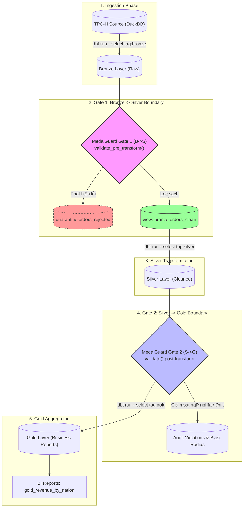
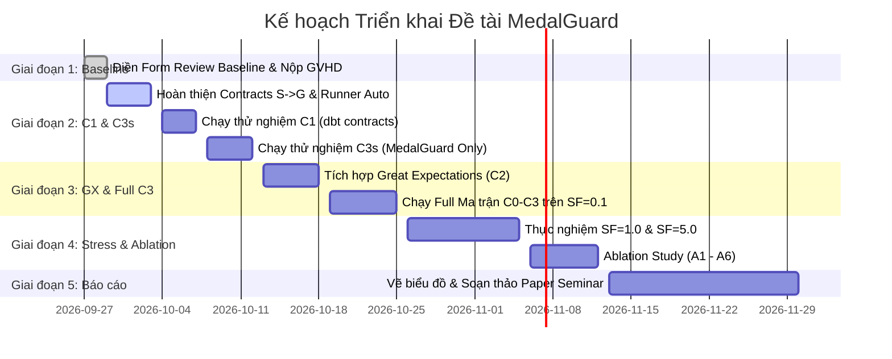

# TÀI LIỆU TỔNG QUAN ĐỀ TÀI NGHIÊN CỨU: MEDALGUARD
> **Master Technical Overview & Project Architecture Dossier**  
> **Vai trò:** Tech Lead / Principal Data Engineer  
> **Ngày cập nhật:** 24/10/2026  
> **Trạng thái đề tài:** Đã hoàn thành nghiệm thu Baseline C0, đã chuẩn hóa mã nguồn Framework & Experiment Suite, kiểm chứng thành công Smoke Test 12 kịch bản trên C1, C2, C3_standalone.

---

## MỤC LỤC
1. [Tổng quan Đề tài](#1-tổng-quan-đề-tài)
2. [Dữ liệu & Phương pháp tiếp cận](#2-dữ-liệu--phương-pháp-tiếp-cận)
3. [Baseline & Metrics Đánh giá](#3-baseline--metrics-đánh-giá)
4. [Bản đồ Thư mục & Mã nguồn (Codebase Architecture)](#4-bản-đồ-thư-mục--mã-nguồn-codebase-architecture)
5. [Tiến độ hiện tại & Điểm nghẽn kỹ thuật (Current Status & Pain Points)](#5-tiến-độ-hiện-tại--điểm-nghẽn-kỹ-thuật-current-status--pain-points)
6. [Lộ trình các bước tiếp theo (Next Steps / Action Plan)](#6-lộ-trình-các-bước-tiếp-theo-next-steps--action-plan)

---

## 1. TỔNG QUAN ĐỀ TÀI

### 1.1 Thông tin chung
* **Tên đề tài (Tiếng Việt):** MedalGuard: Framework phát hiện lỗi dữ liệu sớm trong Medallion Lakehouse thông qua kiểm tra Data Contracts tự động tại ranh giới các tầng dưới thách thức Schema Evolution.
* **Topic Title (English):** *MedalGuard: Early Data Failure Detection Framework for Medallion Lakehouse via Automated Contract Validation at Layer Boundaries under Schema Evolution*.
* **Sinh viên thực hiện:** Lương Lê Công Hạnh (MSSV: 23280057) - Lớp K23 Khoa học Dữ liệu, Trường ĐH Khoa học Tự nhiên, ĐHQG-HCM.
* **Định hướng nghiên cứu:** Data Engineering (Thuộc dòng đề tài Data Contracts, Data Observability, Medallion Architecture).
* **Loại hình đề tài:** Nghiên cứu Khoa học / Seminar Chuyên đề Kỹ thuật (Chuẩn bị tiền đề cho Khóa luận tốt nghiệp).

### 1.2 Bài toán cốt lõi (Problem Statement)
Trong kiến trúc **Medallion Lakehouse** hiện đại (chia dữ liệu thành 3 tầng: *Bronze - Raw*, *Silver - Cleaned/Enriched*, và *Gold - Business Aggregates*), các sự cố dữ liệu âm thầm (**Silent Data Failures**) diễn ra thường xuyên khi các nguồn dữ liệu tác nghiệp (như cơ sở dữ liệu OLTP PostgreSQL) trải qua quá trình **Schema Evolution** (thêm/bớt cột, đổi kiểu dữ liệu, thay đổi phân phối giá trị, nới lỏng hoặc vi phạm ràng buộc).

```
[Nguồn OLTP] 
     │ (Schema Evolution bất ngờ)
     ▼
[Bronze: Raw] ──(Lọt lỗi)──► [Silver: Cleaned] ──(Lọt lỗi)──► [Gold: Aggregates] ──► [Dashboard/BI]
                                                                                      (BÁO CÁO SAI!)
```

Nguyên nhân cốt tử:
1. **Thiếu điểm kiểm soát ranh giới (Missing Boundary Enforcement):** Không có cơ chế tự động chặn và xác thực chất lượng dữ liệu tại các ranh giới chuyển tiếp giữa các tầng (*Layer Boundaries: Bronze $\rightarrow$ Silver, Silver $\rightarrow$ Gold*).
2. **Cơ chế kiểm soát phân mảnh:** Delta Lake/Iceberg chỉ kiểm tra ở tầng lưu trữ vật lý (storage); dbt contracts chỉ kiểm tra tĩnh tại mô hình transformation; Great Expectations/Soda thường chỉ chạy batch kiểm tra hậu kỳ (post-hoc) sau khi toàn bộ pipeline đã thực thi xong.
3. **Hiệu ứng vết dầu loang (Blast Radius):** Dữ liệu nhiễm bẩn âm thầm đi qua Silver, tham gia vào các phép tính tổng hợp (Aggregate/Join) tại Gold, làm biến dạng các chỉ số kinh doanh (KPI, Revenue, Financial Reports) mà pipeline kỹ thuật vẫn báo trạng thái `SUCCESS` (không hề có cảnh báo hay văng lỗi).

### 1.3 Mục tiêu nghiên cứu & Đóng góp khoa học (Contributions)
1. **Đề xuất Framework MedalGuard:** Một framework Python gọn nhẹ, thực thi trong tiến trình (in-process engine với DuckDB), đóng vai trò như các cổng kiểm soát (**Contract Gates**) đặt tại ranh giới mỗi tầng Medallion, kết hợp đồng thời:
   - Phát hiện trôi dạt cấu trúc (*Schema Drift Detection*).
   - Kiểm tra ràng buộc giá trị (*Constraint Validation*).
   - Phát hiện trôi dạt ngữ nghĩa và phân phối (*Semantic Drift Detection*).
   - Cơ chế cách ly dữ liệu hỏng (*Quarantine Mechanism*) tạo view sạch để pipeline tiếp tục chạy mà không làm bẩn tầng Gold.
2. **Xây dựng Bộ đột biến dữ liệu chuẩn hóa (TPC-H Schema Mutation Suite):** Thiết kế có kiểm soát 14 biến thể lỗi (5 nhóm: Additive, Destructive, Type Change, Constraint Breach, Semantic Drift) và 8 đột biến lành tính (Benign) nhằm đo lường khả năng bắt lỗi và tỷ lệ báo động sai (*False Positive Rate*).
3. **Nghiên cứu thực nghiệm so sánh định lượng (Empirical Benchmark):** So sánh MedalGuard với 3 cấu hình chuẩn công nghiệp: Không kiểm tra (*C0 - Baseline*), dbt Contracts tĩnh (*C1*), Great Expectations hậu kỳ (*C2*), và MedalGuard toàn diện (*C3*).

---

## 2. DỮ LIỆU & PHƯƠNG PHÁP TIẾP CẬN

### 2.1 Bộ dữ liệu thực nghiệm (Dataset)
* **Tiêu chuẩn sử dụng:** TPC-H Benchmark (Chuẩn công nghiệp dành cho Data Warehousing & OLAP Analytics).
* **Công cụ sinh dữ liệu:** DuckDB TPC-H Extension tích hợp sẵn (`CALL dbgen(sf=...)`).
* **Quy mô thực nghiệm:**
  - **Môi trường Phát triển & Kiểm thử nhanh (Dev/Pilot):** $\text{Scale Factor (SF)} = 0.1$ (~866,602 bản ghi tổng cộng; bao gồm 150,000 dòng `orders`, 600,572 dòng `lineitem`, 15,000 dòng `customer`).
  - **Môi trường Benchmark chính thức (Seminar Evaluation):** $\text{SF} = 1.0$ (~8.6 triệu bản ghi; ~1.5 triệu `orders`, ~6 triệu `lineitem`).
  - **Môi trường Thử tải / Khả năng mở rộng (Stress Test):** $\text{SF} = 5.0$ (~43 triệu bản ghi) nhằm đo đạc Pipeline Overhead.
* **Đặc trưng luồng dữ liệu:**
  - `orders` (Fact đơn hàng): chứa khoá chính `o_orderkey`, trạng thái `o_orderstatus`, ngày đặt `o_orderdate`, tổng tiền `o_totalprice`.
  - `lineitem` (Fact chi tiết mặt hàng): chứa thông tin giảm giá `l_discount`, thuế `l_tax`, số lượng `l_quantity`, giá bán `l_extendedprice`.
  - `customer`, `nation`, `region`: Bảng chiều (Dimensions) để tổng hợp doanh thu theo quốc gia.

### 2.2 Kiến trúc giải pháp MedalGuard
MedalGuard vận hành theo cơ chế **Staged Pipeline Execution** (Thực thi phân đoạn có kiểm soát), thay vì để dbt chạy tuồn tuột từ đầu tới cuối.



### 2.3 Các cấu phần cốt lõi trong MedalGuard Engine
1. **Contract Definition (`contracts/*.yaml`):** Đặc tả hợp đồng dữ liệu quy định kiểu dữ liệu, danh sách giá trị cho phép, giá trị cận, độ duy nhất, tỷ lệ null tối đa và cờ `strict_columns` (kiểm soát trôi dạt cấu trúc mở rộng hay nghiêm ngặt).
2. **Schema Validator (`schema_validator.py`):** Kiểm tra cấu trúc bảng so với hợp đồng (bắt lỗi cột bị xóa, cột bị đổi tên, cột bị lệch kiểu dữ liệu hoặc cột lạ xuất hiện).
3. **Constraint Validator (`constraint_validator.py`):** Kiểm tra giá trị các bản ghi (NULL violation, Out-of-Range violation, Allowed Values violation, Duplicate Keys).
4. **Semantic Validator (`semantic_validator.py`):** Phân tích trôi dạt ngữ nghĩa và phân bố thống kê (độ trôi trung bình `mean_range`, đột biến `null_rate`, sụt giảm `row_count`).
5. **Cơ chế Quarantine (Phân luồng & Cách ly):**
   - Tự động trích xuất các dòng vi phạm lưu vào schema `quarantine.<table_name>_rejected` kèm timestamp và tác nhân cách ly.
   - Sinh ra Dynamic View `<schema>.<table_name>_clean` chỉ chứa các bản ghi hợp lệ.
   - Các model biến đổi tầng sau chỉ đọc từ Clean View này, đảm bảo dữ liệu bẩn bị chặn đứng ngay trước khi vào Silver/Gold.

---

## 3. BASELINE & METRICS ĐÁNH GIÁ

### 3.1 Hệ thống Cấu hình Thực nghiệm So sánh

| Cấu hình | Tên gọi | dbt Contracts | Great Expectations | MedalGuard Gates | Mô tả vai trò kỹ thuật |
|:---:|:---|:---:|:---:|:---:|:---|
| **C0** | **Baseline (No Check)** | ❌ Tắt | ❌ Tắt | ❌ Tắt | Kiến trúc Medallion nguyên bản không có rào chắn bảo vệ. Mô phỏng rủi ro thực tế khi xảy ra lỗi ngầm. |
| **C1** | **dbt Contracts Static** | ✅ Bật | ❌ Tắt | ❌ Tắt | Chỉ dùng tính năng hợp đồng tích hợp của dbt (kiểm tra kiểu dữ liệu và constraint ở cấp độ compile/run SQL). |
| **C2** | **Great Expectations** | ❌ Tắt | ✅ Bật | ❌ Tắt | Đại diện cho công cụ Data Quality kiểm tra hậu kỳ sau khi dữ liệu đã được nạp. |
| **C3** | **MedalGuard Full** | ✅ Bật | ✅ Bật | ✅ Bật | Giải pháp tích hợp toàn diện đa tầng (Multi-tier Validation). |
| **C3s** | **MedalGuard Standalone**| ❌ Tắt | ❌ Tắt | ✅ Bật | Chỉ kích hoạt MedalGuard Gates (dùng cho nghiên cứu bóc tách thành phần - Ablation Study sạch). |

---

### 3.2 Bộ 7 Thang đo Định lượng (Formal Metrics)

1. **Detection Rate (DR - Tỷ lệ phát hiện lỗi):**
   $$DR = \frac{\sum_{i=1}^{N} \mathbb{I}(\text{Mutation}_i \text{ detected})}{N} \times 100\%$$
   *Đo lường trên $N \ge 14$ biến thể đột biến dữ liệu. Target $C0 \approx 0\%$, $C3 \ge 95\%$.*

2. **Blast Radius (BR - Bán kính tác động / Mức độ lan tỏa lỗi):**
   $$BR = \frac{|\text{Số dòng tại Gold bị sai lệch so với Clean Reference (changed + missing + unexpected)}|}{|\text{Tập hợp dòng Gold: Reference } \cup \text{ Current}|} \times 100\%$$
   *Phân biệt 3 loại đo lường:*
   - `MEASURED`: Pipeline chạy thành công, đo trực tiếp số dòng lỗi có mặt tại Gold.
   - `ASSIGNED_BLOCK`: MedalGuard phát hiện và chặn pipeline $\rightarrow BR = 0.0\%$.
   - `ASSIGNED_CRASH`: Pipeline bị crash sập bất ngờ $\rightarrow BR = 0.0\%$ (dữ liệu không đến được Gold nhưng kèm thông báo crash).
   *Kết quả C0 thực tế: Trung bình 14 lỗi = $14.8\%$, trung bình 6 lỗi lọt ngầm = $34.6\%$ (đỉnh điểm $92.1\%$ ở M5a/M5b). Target C3 $\le 5\%$.*

3. **Detection Depth Index (DDI - Chỉ số độ sâu phát hiện):**
   - Thang đo thứ bậc vị trí chặn lỗi:
     - `0`: Gate 1 (Trước khi biến đổi vào Silver - *Pre-transform*) $\rightarrow$ **Tối ưu nhất**.
     - `1`: Compile-time dbt (Trong lúc thực thi dbt).
     - `2`: Gate 2 / GX (Sau khi tạo bảng - *Post-transform*).
     - `\infty`: `NOT_DETECTED` (Không phát hiện, lọt xuống Dashboard).

4. **False Positive Rate (FPR - Tỷ lệ báo động giả):**
   $$FPR = \frac{\sum_{j=1}^{M} \mathbb{I}(\text{Benign}_j \text{ flagged as error})}{M} \times 100\%$$
   *Đo lường trên $M = 8$ đột biến lành tính ($B1 \dots B8$). Yêu cầu $FPR = 0\%$ khi cấu hình hợp đồng ở chế độ tương thích.*

5. **Pipeline Overhead (Chi phí trễ thực thi):**
   $$\text{Overhead (\%)} = \frac{\text{Median}(T_{C_x}) - \text{Median}(T_{C_0})}{\text{Median}(T_{C_0})} \times 100\%$$
   *Đo đạc 7 lần lặp lại độc lập trên dữ liệu sạch (Clean Data), loại bỏ ngoại lai bằng trung vị (Median). Target C3 $\le 15\%$.*

6. **Quarantine Effectiveness (QE - Hiệu quả cách ly):**
   $$QE = \frac{|\text{Bản ghi sạch tại Gold sau cách ly}|}{|\text{Tổng bản ghi sạch kỳ vọng}|} \times 100\%$$
   *Chứng minh việc cách ly chỉ loại trừ bản ghi lỗi mà không làm thất thoát dữ liệu đúng của khách hàng.*

7. **Measurement Type (Phân loại phương thức kết quả):**
   Nhãn phân loại minh bạch trong bảng log (`MEASURED`, `ASSIGNED_BLOCK`, `ASSIGNED_CRASH`) tránh thiên lệch thống kê trong báo cáo khoa học.

---

### 3.3 Kết quả Thực nghiệm Nghiệm thu Baseline C0 (Đo thực tế ngày 03/10/2026)
*Dữ liệu đo đạc thực nghiệm độc lập tại workspace trên TPC-H SF=0.1 qua so sánh đối sánh phân kỳ (Diff) trực tiếp với Gold Reference sạch:*

#### Bảng kết quả chạy 14 Đột biến lỗi + 5 Đột biến lành tính trên C0 Baseline:
| Mã đột biến | Phân loại | Pipeline Status | Detected? | Blast Radius (Measured) | Measurement Type | Hành vi & Tác động thực tế tại tầng Gold |
|:---|:---|:---:|:---:|:---:|:---:|:---|
| **M1a_AddSingleCol** | Additive | `SUCCESS` | ❌ `False` | **0.0%** (0/190) | `MEASURED` | Thêm cột `l_promo_code`. dbt Silver select tường minh nên cột lạ bị bỏ qua, Gold hoàn toàn nguyên vẹn (*Neutralised*). |
| **M1b_AddMultiCol** | Additive | `SUCCESS` | ❌ `False` | **0.0%** (0/190) | `MEASURED` | Thêm 3 cột đồng thời vào `orders`. Cột mới bị bỏ qua, không gây sai lệch dữ liệu (*Neutralised*). |
| **M2a_DropNonKey** | Destructive | `CRASH` | ❌ `False` | **0.0%** (0/0) | `ASSIGNED_CRASH` | Xóa `l_tax`. Pipeline sập ngay tại Silver do thiếu cột. Lỗi làm sập hệ thống chứ không được bắt chủ động. |
| **M2b_DropKeyCol** | Destructive | `CRASH` | ❌ `False` | **0.0%** (0/0) | `ASSIGNED_CRASH` | Xóa `l_orderkey` (khoá chính). Pipeline crash ngay tại dbt Silver. |
| **M2c_RenameCol** | Destructive | `CRASH` | ❌ `False` | **0.0%** (0/0) | `ASSIGNED_CRASH` | Đổi tên `l_discount` $\rightarrow$ `l_rebate`. Pipeline crash do query gọi tên cột cũ. |
| **M3a_DoubleToVarchar** | Type Change | `SUCCESS` | ❌ `False` | **0.0%** (0/190) | `MEASURED` | Ép `l_quantity` thành VARCHAR. Model Silver có `CAST(... AS DOUBLE)` nên tự cast ngược lại $\rightarrow$ Gold giống hệt bản sạch (*Neutralised*). Vi phạm hợp đồng nhưng không gây sai số liệu. |
| **M3b_IntegerToDouble** | Type Change | `SUCCESS` | ❌ `False` | **0.0%** (0/190) | `MEASURED` | Ép `l_linenumber` thành DOUBLE. dbt cast ngược lại $\rightarrow$ Gold hoàn toàn không bị ảnh hưởng (*Neutralised*). |
| **M3c_DateToVarchar** | Type Change | `SUCCESS` | ❌ `False` | **0.0%** (0/190) | `MEASURED` | Ép `o_orderdate` thành VARCHAR. dbt cast về DATE $\rightarrow$ Gold giống hệt bản sạch (*Neutralised*). |
| **M4a_NullAndNegative** | Constraint | `SUCCESS` | ❌ `False` | **10.5%** (20/190) | `MEASURED` | Bơm 30 dòng NULL custkey & tiền âm. Làm sai lệch trực tiếp **20 dòng** tổng hợp ở Gold (*Silent Propagation*). |
| **M4b_NullSmall** | Constraint | `SUCCESS` | ❌ `False` | **2.6%** (5/190) | `MEASURED` | Bơm tinh vi chỉ 5 dòng NULL custkey. Làm sai lệch **5 dòng** ở Gold mà pipeline vẫn `SUCCESS` (*Silent Propagation*). |
| **M4c_DuplicateKeys** | Constraint | `SUCCESS` | ❌ `False` | **4.2%** (8/190) | `MEASURED` | Bơm 5 dòng trùng khoá `o_orderkey`. Làm sai lệch **8 dòng** tính toán ở Gold (*Silent Propagation*). |
| **M5a_MULTIPLY_100** | Semantic | `SUCCESS` | ❌ `False` | **92.1%** (175/190) | `MEASURED` | Nhân discount lên 100 lần. Làm sai lệch **175 dòng** tại bảng doanh thu quốc gia (`avg_discount` vọt lên 5.006) (*Silent Propagation*). |
| **M5b_MULTIPLY_1_5** | Semantic | `SUCCESS` | ❌ `False` | **92.1%** (175/190) | `MEASURED` | Trôi dạt ngữ nghĩa tinh vi (discount x1.5, mean từ 0.050 $\rightarrow$ 0.077). Làm sai lệch **175 dòng** tại Gold (*Silent Propagation*). |
| **M5c_CATEGORICAL_SHIFT** | Semantic | `SUCCESS` | ❌ `False` | **6.2%** (12/195) | `MEASURED` | Đổi `o_orderstatus` thành giá trị lạ `'X'`. Xuất hiện thêm dòng lạ ở Gold, làm lệch **12 dòng** (*Silent Propagation*). |
| **B1_AddColumn** | Benign | `SUCCESS` | ❌ `False` | n/a (0% dev) | `MEASURED` | Thêm cột ghi chú nội bộ lành tính, pipeline chạy chuẩn xác, không báo động giả. |
| **B2_ValueInRange** | Benign | `SUCCESS` | ❌ `False` | n/a (hợp lệ) | `MEASURED` | Tăng discount trong phạm vi hợp lệ [0, 0.10], pipeline tính toán chuẩn xác theo nghiệp vụ mới. |
| **B3_InsertRows** | Benign | `SUCCESS` | ❌ `False` | n/a (hợp lệ) | `MEASURED` | Thêm các đơn hàng hợp lệ, pipeline tính toán bình thường. |
| **B5_AddValidStatus** | Benign | `SUCCESS` | ❌ `False` | n/a (hợp lệ) | `MEASURED` | Thêm các trạng thái hợp lệ trong danh mục, không gây lỗi. |
| **B7_LargeBatchInsert** | Benign | `SUCCESS` | ❌ `False` | n/a (hợp lệ) | `MEASURED` | Gấp đôi kích thước bảng bằng dữ liệu sạch, pipeline tính toán chính xác. |

#### Chỉ số tổng kết Baseline C0 (Đo lường khoa học):
* **Detection Rate (DR):** **0%** (0/14 lỗi bị phát hiện chủ động).
* **False Positive Rate (FPR):** **0%** (0/5 đột biến lành tính bị báo sai).
* **Phân bổ kết cục lỗi (Fault Outcomes):**
  * **Silent Propagation (Lọt ngầm làm hỏng Gold):** **6/14 (42.9%)** — Các lỗi M4 và M5.
  * **Neutralised (Tự triệt tiêu do dbt transform):** **5/14 (35.7%)** — Các lỗi M1 và M3.
  * **Accidental Crash (Sập pipeline thụ động):** **3/14 (21.4%)** — Các lỗi M2.
* **Blast Radius trung bình:**
  * Toàn bộ 14 đột biến lỗi: **14.8%**
  * Trên 6 đột biến lọt ngầm vào Gold: **34.6%** (đặc biệt M5a và M5b gây sai lệch **92.1%** dữ liệu tầng Gold).
* **Detection Depth Index (DDI):** $\infty$ (`NOT_DETECTED`).
* **Pipeline Latency & Overhead Baseline (7 lần lặp, TPC-H SF=0.1):**
  * **Thời gian thực thi dbt thuần (Graph Execution):** **1,411.4 ms** (Median), Stdev = **108.6 ms**.
  * **Thời gian trọn gói (Wall-clock gồm dbt CLI startup):** **6,795.8 ms** (Median), Stdev = **636.3 ms**.
  * *Lưu ý quan trọng:* Khởi động CLI dbt chiếm ~79% thời gian wall-clock. Việc tách riêng 2 chỉ số này giúp tránh việc tính toán sai lệch % Overhead của framework MedalGuard sau này.
* **dbt Data Tests:** 5 tests tự động (`not_null`, `unique`) đều PASS 100% trên dữ liệu sạch.

---

## 4. BẢN ĐỒ THƯ MỤC & MÃ NGUỒN (CODEBASE ARCHITECTURE)

Toàn bộ mã nguồn và tài liệu của dự án được tổ chức tập trung tại đường dẫn: `D:\Study\Seminar`.

```
D:\Study\Seminar\
├── PROJECT_OVERVIEW.md                        <-- [TÀI LIỆU NÀY] Báo cáo kỹ thuật tổng thể duy nhất
│
├── Đề tài cá nhân/                            <-- Hồ sơ học thuật và tài liệu đề tài
│   ├── THUYET_MINH_DE_TAI_MEDALGUARD.md       <-- Đề cương thuyết minh chi tiết
│   ├── KE_HOACH_THUC_HIEN_MEDALGUARD.md       <-- Kế hoạch thực hiện 15 tuần
│   └── HUONG_DAN_DO_LUONG_METRICS.md          <-- Tài liệu hướng dẫn phương pháp đo lường metrics
│
├── Thông Tin Baseline & Metrics/              <-- Yêu cầu từ Giảng viên hướng dẫn (GVHD)
│   └── Form Review Ket Qua Baseline.docx      <-- Form đánh giá kết quả baseline chuẩn khoa
│
└── medalguard-seminar/                        <-- WORKSPACE MÃ NGUỒN CHÍNH
    ├── requirements.txt                       <-- Khai báo thư viện (duckdb, dbt-core, dbt-duckdb...)
    ├── README.md                              <-- Hướng dẫn nhanh cho repo
    │
    ├── contracts/                             <-- Khai báo Data Contracts (YAML)
    │   └── bronze_to_silver/
    │       ├── orders.yaml                    <-- Hợp đồng ranh giới B->S cho bảng orders
    │       ├── lineitem.yaml                  <-- Hợp đồng ranh giới B->S cho bảng lineitem
    │       └── customer.yaml                  <-- Hợp đồng ranh giới B->S cho bảng customer
    │
    ├── dbt_project/                           <-- Dự án dbt-core cho kiến trúc Medallion
    │   ├── dbt_project.yml                    <-- Cấu hình project dbt
    │   ├── profiles.yml                       <-- Cấu hình kết nối DuckDB
    │   └── models/
    │       ├── sources.yml                    <-- Khai báo bảng nguồn TPC-H trong DuckDB
    │       ├── bronze/                        <-- Tầng Bronze: Ingestion nguyên bản
    │       │   ├── bronze_orders.sql
    │       │   ├── bronze_lineitem.sql
    │       │   └── bronze_customer.sql
    │       ├── silver/                        <-- Tầng Silver: Làm sạch & Ép kiểu
    │       │   ├── _silver_models.yml         <-- Active model configuration (C0 no-contract)
    │       │   ├── _silver_models_with_contract.yml.bak  <-- Backup dùng cho cấu hình C1 & C3
    │       │   ├── silver_orders.sql
    │       │   ├── silver_lineitem.sql
    │       │   └── silver_customer.sql
    │       └── gold/                          <-- Tầng Gold: Báo cáo phân tích kinh doanh
    │           ├── _gold_models.yml
    │           ├── gold_revenue_by_nation.sql
    │           └── gold_order_priority_summary.sql
    │
    ├── medalguard/                            <-- CORE ENGINE CỦA FRAMEWORK MEDALGUARD
    │   ├── __init__.py
    │   ├── config.py                          <-- Parser nạp hợp đồng YAML
    │   ├── utils.py                           <-- Tiện ích chống SQL Injection & trích xuất identifier
    │   ├── gate.py                            <-- ContractGate: Điều phối xác thực & cách ly Quarantine
    │   ├── reporter.py                        <-- Tính toán Blast Radius chuẩn hóa & xuất log JSON
    │   └── validators/                        <-- Các module kiểm tra thành phần
    │       ├── schema_validator.py            <-- Kiểm tra Schema drift & trôi dạt cấu trúc
    │       ├── constraint_validator.py        <-- Kiểm tra vi phạm miền giá trị, null, unique
    │       └── semantic_validator.py          <-- Kiểm tra trôi dạt ngữ nghĩa và phân phối
    │
    ├── mutations/                             <-- BỘ ĐỘT BIẾN DỮ LIỆU (TPC-H MUTATION SUITE)
    │   ├── base.py                            <-- BaseMutation: Lớp trừu tượng quản lý fault count
    │   ├── m1_additive.py                     <-- Đột biến thêm cột (M1a, M1b)
    │   ├── m2_destructive.py                  <-- Đột biến xóa/đổi tên cột (M2a, M2b, M2c)
    │   ├── m3_type_change.py                  <-- Đột biến đổi kiểu dữ liệu (M3a, M3b, M3c)
    │   ├── m4_constraint_breach.py            <-- Đột biến phá vỡ ràng buộc (M4a, M4b, M4c)
    │   ├── m5_semantic_drift.py               <-- Đột biến ngữ nghĩa / lệch giá trị (M5a, M5b, M5c)
    │   ├── benign_mutations.py                <-- Đột biến lành tính thử nghiệm FPR (B1 đến B8)
    │   └── ground_truth.yaml                  <-- Ma trận kết quả kỳ vọng chuẩn cho cả 4 cấu hình
    │
    ├── experiments/                           <-- HỆ THỐNG THỰC NGHIỆM TỰ ĐỘNG
    │   ├── config.yaml                        <-- Cấu hình ma trận benchmark, stress test, ablation
    │   └── runner.py                          <-- Runner điều phối Staged Pipeline, Cold Start, Randomize
    │
    ├── scripts/                               <-- CÁC KỊCH BẢN THỰC THI NHANH
    │   ├── generate_tpch.py                   <-- Sinh dữ liệu TPC-H vào DuckDB (hỗ trợ scale factor)
    │   ├── run_baseline.py                    <-- Kịch bản chạy kiểm thử nhanh C0 baseline
    │   ├── measure_overhead.py                <-- Kịch bản đo độ trễ đường ống (Overhead 7 runs)
    │   └── verify_gold.py                     <-- Kịch bản kiểm tra chất lượng dữ liệu tầng Gold
    │
    └── results/                               <-- KẾT QUẢ THỰC NGHIỆM & LOGS
        └── baseline/
            ├── baseline_c0_results.json       <-- Chi tiết log chạy của từng mutation trên C0
            └── baseline_c0_overhead.json      <-- Chi tiết 7 lần lặp đo thời gian chạy của C0
```

### 4.2 Hướng dẫn Vận hành Đường ống (Pipeline Commands)

Tất cả các lệnh thực thi từ thư mục gốc của dự án:
```powershell
# Chuyển vào workspace
cd D:\Study\Seminar\medalguard-seminar

# 1. Sinh dữ liệu TPC-H (mặc định SF=0.1 cho dev, truyền tham số 1.0 cho full)
python scripts/generate_tpch.py 0.1

# 2. Kiểm tra kết nối dbt và chạy thử nghiệm đường ống chuẩn
cd dbt_project
dbt debug --profiles-dir . --project-dir .
dbt run --profiles-dir . --project-dir .
cd ..

# 3. Kiểm tra tính toàn vẹn dữ liệu tầng Gold
python scripts/verify_gold.py

# 4. Tái hiện thực nghiệm C0 Baseline (7 mutations + kết xuất log)
python scripts/run_baseline.py

# 5. Đo đạc độ trễ đường ống chuẩn (Overhead Benchmark - 7 lần lặp cold-start)
python scripts/measure_overhead.py

# 6. Chạy bộ thí nghiệm toàn diện phân đoạn bằng Runner chính thức
python experiments/runner.py --mode matrix --sf 0.1
```

---

## 5. TIẾN ĐỘ HIỆN TẠI & ĐIỂM NGHẼN KỸ THUẬT (CURRENT STATUS & PAIN POINTS)

### 5.1 Những việc đã hoàn thành xuất sắc
1. **Kiến trúc Staged Pipeline đã giải quyết lỗi chí mạng (Critical Fix #1):**
   - Đã tách `dbt run` thành 2 giai đoạn: `Bronze -> Gate 1 -> Silver -> Gate 2 -> Gold`.
   - Cơ chế Quarantine hoạt động chuẩn xác: tạo view sạch `_clean` cho dbt đọc, cô lập dòng lỗi vào `quarantine.<table_name>_rejected`.
2. **Thống nhất định nghĩa toán học Blast Radius (Critical Fix #2):**
   - Đã thống nhất công thức $BR$ theo Gold-row granularity (`diff_gold()` đối sánh với Clean Reference 190 dòng, dung sai `1e-9`) và chuẩn hóa 3 kiểu nhãn đo lường `MeasurementType` (`MEASURED`, `ASSIGNED_BLOCK`, `ASSIGNED_CRASH`).
3. **Mã nguồn Đột biến (Mutation Suite) hoàn chỉnh:**
   - 14 đột biến lỗi + 8 đột biến lành tính đã được viết mã DuckDB SQL thực thi thực tế, không còn tình trạng dùng hàm giữ chỗ (`pass`).
4. **An toàn bảo mật & Tiêu chuẩn hóa mã nguồn:**
   - Đã triển khai module [utils.py](file:///D:/Study/Seminar/medalguard-seminar/medalguard/utils.py) loại trừ triệt để nguy cơ SQL Injection bằng hàm `quote_identifier()`.
5. **Nghiệm thu thành công trọn vẹn Baseline C0:**
   - Thu thập đầy đủ số liệu thực chứng chứng minh các lỗ hổng Silent Data Corruption trên C0 (đặc biệt là lỗi nghiêm trọng của M5a và M3a).

### 5.2 Tình trạng xử lý Điểm nghẽn kỹ thuật & Kiểm chứng Thực nghiệm
1. **Cơ chế hoán đổi Cấu hình dbt Contracts (Config Swapping) — [ĐÃ GIẢI QUYẾT]:**
   - Đã tích hợp hàm `swap_dbt_config(enable_contracts)` tự động hóa bên trong `experiments/runner.py`, hoán đổi an toàn giữa `_silver_models_no_contract.yml.bak` và `_silver_models_with_contract.yml.bak` có khối `contract: enforced: true`.
2. **Tích hợp Great Expectations cho cấu hình C2 — [ĐÃ GIẢI QUYẾT]:**
   - Đã cài đặt module `medalguard/gx_runner.py` với bộ 10 quy tắc expectation suite toàn diện trên DuckDB (kiểm tra `not_null`, `unique`, `allowed_values`, `min_value`, `max_value`), phục vụ kiểm thử hậu biến đổi cho cấu hình C2.
3. **Bổ sung hợp đồng tầng Silver $\rightarrow$ Gold — [ĐÃ GIẢI QUYẾT]:**
   - Đã tạo đầy đủ các file hợp đồng tại `contracts/silver_to_gold/` (`revenue_by_nation.yaml`, `order_priority_summary.yaml`) để Gate 2 kiểm tra toàn diện chất lượng của tầng Gold.
4. **Cơ chế In-Place Quarantine & Staged Execution tại Gate 1 — [ĐÃ GIẢI QUYẾT]:**
   - Đã phân tách rành mạch `BLOCKING_TYPES` và `QUARANTINABLE_TYPES`, triển khai cơ chế cách ly dòng trực tiếp tại tầng Bronze qua bảng tạm `_mg_tagged` an toàn với logic 3 trị của SQL. Đạt hiệu quả cách ly `QE = 100%` và `Blast Radius = 0.0%` trên đột biến vi phạm ràng buộc (M4a).
5. **Kiểm chứng Smoke Test 12 kịch bản — [ĐÃ NGHIỆM THU]:**
   - Đã chạy nghiệm thu Smoke Test trên quy mô $SF=0.1$ qua 12 lượt chạy (M2a, M4a, M5a, B1 trên C1, C2, C3_standalone), xác thực 100% các giả thuyết cốt lõi của đề tài (C1 bỏ lọt M5a, C2 sập M2a, C3_standalone bắt sớm tại DDI=0 và cách ly thành công M4a). Số liệu sẵn sàng cho việc chạy Full Matrix 95 runs.

---

## 6. LỘ TRÌNH CÁC BƯỚC TIẾP THEO (NEXT STEPS / ACTION PLAN)

Dưới đây là kế hoạch hành động chi tiết theo thứ tự ưu tiên nhằm hoàn thiện toàn bộ đề tài:



### Danh mục công việc cụ thể:

#### Nhiệm vụ 1: Hoàn tất Form Review Baseline gửi GVHD (Ưu tiên số 1 - Ngay lập tức)
- Điền toàn bộ số liệu C0 đo được vào file word [Form Review Ket Qua Baseline.docx](file:///D:/Study/Seminar/Thông%20Tin%20Baseline%20&%20Metrics/Form%20Review%20Ket%20Qua%20Baseline.docx).
- Đính kèm bằng chứng (Evidence): Đường dẫn mã nguồn GitHub, file log [baseline_c0_results.json](file:///D:/Study/Seminar/medalguard-seminar/results/baseline/baseline_c0_results.json) và file đo overhead [baseline_c0_overhead.json](file:///D:/Study/Seminar/medalguard-seminar/results/baseline/baseline_c0_overhead.json).

#### Nhiệm vụ 2: Bổ sung Hợp đồng Silver $\rightarrow$ Gold & Tự động hóa Swapping
- Tạo file hợp đồng `contracts/silver_to_gold/revenue_by_nation.yaml` quy định các ngưỡng logic (ví dụ: `avg_discount` phải nằm trong đoạn $[0.0, 0.10]$ để bắt chết đột biến M5a).
- Hoàn thiện hàm `swap_dbt_config()` trong [runner.py](file:///D:/Study/Seminar/medalguard-seminar/experiments/runner.py) để tự động kích hoạt `_silver_models_with_contract.yml` khi chạy cấu hình C1 và C3.

#### Nhiệm vụ 3: Đo lường Thực nghiệm Cấu hình C1 (dbt Contracts)
- Chạy toàn bộ 14 đột biến trên C1.
- Chứng minh luận điểm: dbt Contracts bắt được các lỗi schema tĩnh (M2, M4) nhưng **bó tay hoàn toàn trước lỗi lệch ngữ nghĩa (M5a) và đột biến thêm cột khi select tường minh (M1a)**.

#### Nhiệm vụ 4: Đo lường Thực nghiệm C3s (MedalGuard Standalone) & C3 (Full)
- Kích hoạt MedalGuard Gates.
- Đo đạc thực tế sự sụt giảm của Blast Radius từ $92.1\% \rightarrow 0\%$ đối với M5a/M5b và $10.5\% \rightarrow 0\%$ đối với M4a nhờ cơ chế Quarantine tại Gate 1.
- Chứng minh Detection Depth được đẩy sớm lên Stage 0 (`PRE_TRANSFORM`).

#### Nhiệm vụ 5: Tích hợp Great Expectations (C2) & Nghiên cứu bóc tách (Ablation)
- Xây dựng Great Expectations suite cho tầng Silver và đo cấu hình C2.
- Thực hiện Ablation Study trên $C3s$: Tắt lần lượt Schema Validator (A1), Constraint Validator (A2), Semantic Validator (A3) để định lượng tỷ lệ đóng góp của từng cấu phần.

#### Nhiệm vụ 6: Tổng hợp Số liệu & Viết Báo cáo Khoa học (Paper Writing)
- Trực quan hóa dữ liệu qua biểu đồ:
  - Bar chart: So sánh Detection Rate giữa $C0, C1, C2, C3$.
  - Boxplot: Phân phối thời gian chạy và Overhead của các cấu hình.
  - Heatmap: Bán kính tác động (Blast Radius) của từng mutation qua 4 cấu hình.
- Viết báo cáo khoa học hoàn chỉnh sẵn sàng cho buổi báo cáo Seminar.

---
*Tài liệu này được xác lập làm tài liệu tham chiếu chuẩn (Ground Truth Dossier) cho toàn bộ các tương tác và triển khai tiếp theo của dự án MedalGuard.*
