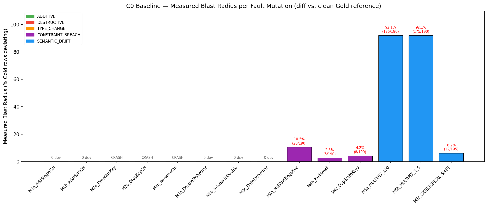
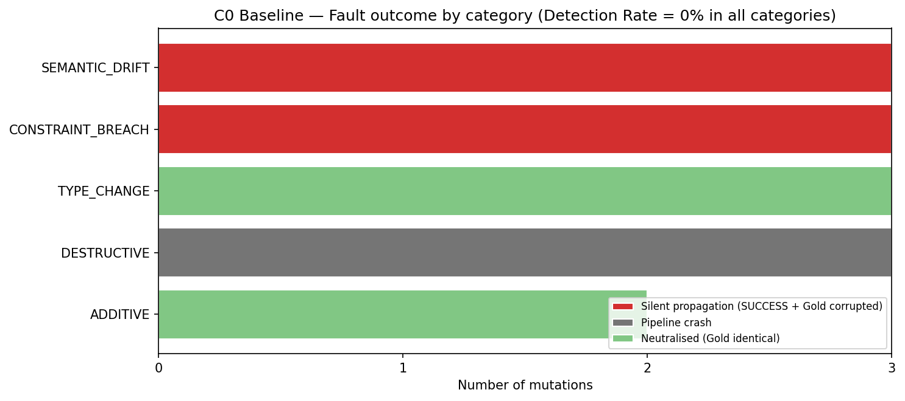
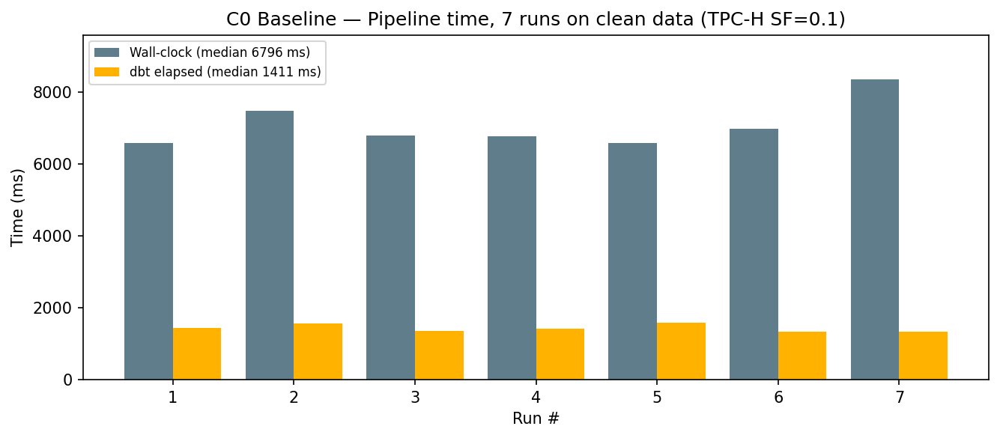

# MedalGuard

> **MedalGuard: Early Data Failure Detection Framework for Medallion Lakehouse via Automated Contract Validation at Layer Boundaries under Schema Evolution**

**Author:** Lương Lê Công Hạnh (MSSV: 23280057)  
**Program:** K23 Data Science, University of Science, VNU-HCM (HCMUS)  
**Course:** Data Science Seminar (Fall 2026)

---

## 📌 Overview

In Medallion Lakehouse architectures (Bronze → Silver → Gold), data faults originating at the ingestion layer (schema drift, constraint breaches, semantic shifts) frequently propagate silently to business analytics tables (Gold layer). **MedalGuard** is a contract-driven data failure detection and staged quarantine framework designed to intercept and isolate data corruptions at layer boundaries before they impact downstream decisions.

---

## 📊 Milestone 2: Baseline C0 Experimental Results

Baseline C0 represents an unmonitored Lakehouse pipeline (Bronze → Silver → Gold without contract enforcement). Experiments were executed on TPC-H Benchmark (SF=0.1, 866,602 rows) across **14 fault mutations** (M1a–M5c) and **5 benign mutations** (B1, B2, B3, B5, B7).

### 1. Summary Metrics

| Metric | Baseline C0 Value | Target C3 (MedalGuard) | Research Assessment |
|:---|:---:|:---:|:---|
| **Detection Rate (DR)** | **0%** (0/14) | $\ge 95\%$ | Baseline has no validation gates; misses all faults |
| **False Positive Rate (FPR)** | **0%** (0/5) | $\le 5\%$ | No false alarms on benign business schema changes |
| **Fault Outcomes** | — | — | 6 Silent Propagation (42.9%), 5 Neutralised (35.7%), 3 Accidental Crash (21.4%) |
| **Blast Radius (Overall)** | **14.8%** | $\le 5\%$ | Row-level deviation measured via `FULL OUTER JOIN` against clean Gold reference |
| **Blast Radius (Silent)** | **34.6%** | $\le 0\%$ | M5a/M5b corrupts 92.1% of national revenue summary |
| **Detection Depth Index** | $\infty$ | $0$ (Gate 1) | No pre-transform detection; faults reach Gold dashboard |
| **dbt Execution Latency** | **1,411 ms** | $< 1,600\text{ ms}$ | Median of 7 clean runs ($\sigma = 109\text{ ms}$) |
| **Wall-clock Pipeline Time**| **6,796 ms** | — | Includes ~79% dbt CLI/Python startup overhead |

### 2. Visual Evidence & Analysis

| Blast Radius per Mutation | Fault Outcome by Category |
|:---:|:---:|
|  |  |

| Pipeline Latency Overhead (7 Runs on Clean Data) |
|:---:|
|  |

---

## 🛠️ Project Structure

```
medalguard-seminar/
├── dbt_project/          # dbt models (Bronze -> Silver -> Gold)
│   ├── macros/           # Schema name resolution macro
│   ├── models/           # bronze/, silver/, gold/ SQL models
│   └── profiles.yml      # Local DuckDB connection profile
├── medalguard/           # MedalGuard framework core
│   ├── gate.py           # ContractGate orchestrator & staged quarantine
│   ├── reporter.py       # Metrics & Blast Radius calculator
│   ├── validators/       # Schema, Constraint, and Semantic validators
│   └── utils.py          # Secure SQL identifier quote utility
├── contracts/            # YAML data contract definitions
├── mutations/            # 14 fault mutations + 5 benign mutations
├── results/baseline/     # Raw experiment JSON logs & PNG charts
├── scripts/              # Reproduction & measurement scripts
│   ├── generate_tpch.py  # Clean TPC-H data generator
│   ├── run_baseline.py   # Full 19-experiment matrix runner
│   ├── measure_overhead.py # 7-run pipeline overhead benchmark
│   └── visualize_baseline.py # Chart generation script
└── requirements.txt      # Python dependencies
```

---

## 🚀 Quick Start & Reproducibility

### 1. Environment Setup
```bash
# Clone the repository
git clone <YOUR_REPO_URL>
cd medalguard

# Create and activate virtual environment
python -m venv .venv
.venv\Scripts\activate       # Windows
# source .venv/bin/activate  # Linux/Mac

# Install dependencies
pip install -r requirements.txt
```

### 2. Generate Benchmark Data & Run Pipeline
```bash
# Generate TPC-H SF=0.1 data (~100MB into DuckDB)
python scripts/generate_tpch.py 0.1

# Run dbt transformations (Bronze -> Silver -> Gold)
cd dbt_project
dbt run
cd ..
```

### 3. Run Experiments & Generate Evidence
```bash
# Run all 19 baseline experiments (14 faults + 5 benign)
python scripts/run_baseline.py

# Measure clean pipeline latency (7 repetitions)
python scripts/measure_overhead.py

# Generate visualization charts & summary JSON
python scripts/visualize_baseline.py
```

All experimental results will be exported to `results/baseline/`.
