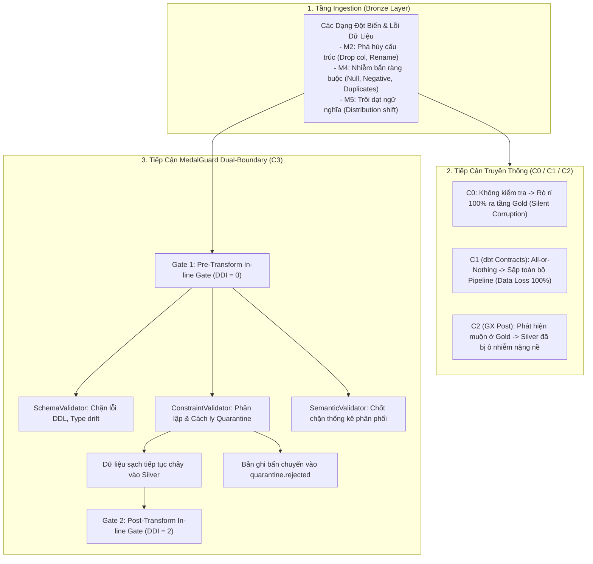

# BÁO CÁO PHÂN TÍCH LỖI CHUYÊN SÂU (E4) & HỒ SƠ TÁI LẬP THỰC NGHIỆM (E5)
**ĐỀ TÀI:** MedalGuard — Early Data Failure Detection Framework for Medallion Lakehouse  
**HỌC VIÊN:** Lương Lê Công Hạnh | **MSSV:** 23280057 | **BẬC:** Thạc sĩ KHTT  
**TRỌNG TÂM:** Phân tích 3 Nhóm Lỗi Điển hình (Failure Taxonomies), Đánh đổi Chất lượng – Độ trễ – Chi phí, Giới hạn Nghiên cứu (Threats to Validity) và Hồ sơ Tái lập 1-click.

---

## 1. PHÂN TÍCH 3 NHÓM LỖI ĐIỂN HÌNH (FAILURE TAXONOMIES) & VÍ DỤ TRƯỚC–SAU

Bộ thực nghiệm MedalGuard v2 được thiết kế dựa trên 24 kịch bản lỗi có hại (`Harmful Scenarios`) được phân bố thành 5 nhóm đột biến (`M1` đến `M5`). Dưới đây là phân tích chi tiết cơ chế phát sinh, hậu quả thực tế và hiệu quả ngăn chặn của MedalGuard trên 3 nhóm lỗi kinh điển trong các Data Lakehouse hiện đại:



---

### Nhóm 1: Lỗi Phá Hủy Cấu Trúc & Thay Đổi Kiểu Dữ Liệu Ngầm (Structural & Type Mutations)
*Đại diện điển hình: `M2a_DropNonKey` (Drop `l_tax`), `M2d_DropCustomerNationKey`, `M3a_DoubleToVarchar`, `M3e_OrdersCustkeyToVarchar`.*

1. **Cơ chế & Hậu quả khi Chưa có MedalGuard (`C0`, `C1`, `C2`):**
   - Khi hệ thống nguồn (e.g., CDC Postgres/MySQL) bất ngờ xóa hoặc đổi tên cột `l_tax`, tầng Bronze vẫn nạp thô thành công.
   - Ở **`C0`** và **`C2`**: Khi dbt bắt đầu biên dịch và thực thi mô hình `silver_lineitem.sql`, câu truy vấn `SELECT l_tax FROM bronze.bronze_lineitem` lập tức sập với lỗi `Catalog Error: Column with name l_tax does not exist`. Đây là hiện tượng **Accidental Crash** (sập ngoài ý muốn do hệ cơ sở dữ liệu quăng ngoại lệ, không phải do hệ thống giám sát chủ động phát hiện).
   - Ở **`C1` (`dbt contracts`)**: Mặc dù bắt được lỗi thông qua `contract: {enforced: true}`, dbt contracts chỉ bắt được ở **DDI = 1** (trong lúc build Silver) và **bỏ cuộc hoàn toàn (fail hard)**, không lưu vết báo cáo cấu trúc, không có gợi ý sửa đổi, và ngắt quãng toàn bộ SLA của luồng dữ liệu.
2. **Cơ chế Ngăn chặn của MedalGuard (`C3`):**
   - Ngay tại ranh giới Ingestion (Gate 1), `SchemaValidator` so khớp siêu dữ liệu thực tế của bảng với Hợp đồng dữ liệu `contracts/bronze_to_silver/lineitem.yaml`.
   - Trong **`~1.2 ms`**, Gate 1 xác định cột bắt buộc `l_tax` bị thiếu (`MISSING_COLUMN`), kích hoạt trạng thái `BLOCKED` ngay tại **DDI = 0** (`PRE_TRANSFORM`).
   - Pipeline chủ động dừng trước khi dbt Silver tiêu tốn năng lực tính toán. Circuit Breaker được kích hoạt, đồng thời thông báo cảnh báo chi tiết qua Webhook/Email được gửi tới Data Platform Team kèm câu lệnh ALTER TABLE để khắc phục.

---

### Nhóm 2: Nhiễm Bẩn Ràng Buộc Cấp Dòng & Trùng Khóa Chính (Row-level Constraints & Duplicates)
*Đại diện điển hình: `M4a_NullAndNegative` (30 dòng lỗi Null/Âm), `M4c_DuplicateKeys` (5 khóa trùng), `M4e_CustomerDuplicateKeys`.*

1. **Cơ chế & Hậu quả khi Chưa có MedalGuard (`C0` vs `C1`):**
   - **Ở `C0` (Baseline):** 30 dòng dữ liệu chứa `o_totalprice < 0` và `o_orderdate IS NULL` đi xuyên suốt từ Bronze $\rightarrow$ Silver $\rightarrow$ Gold mà không gặp bất kỳ rào cản nào. Hậu quả thực nghiệm đo được: **Blast Radius = 10.53%** (làm sai lệch số liệu doanh thu của 2/19 quốc gia trên bảng báo cáo tài chính Gold).
   - **Ở `C1` (`dbt contracts`):** dbt contracts phát hiện vi phạm `not_null` hoặc `check constraints`. Tuy nhiên, triết lý của dbt contracts là **All-or-Nothing**. Vì 30 dòng lỗi (chỉ chiếm **0.02%** trên tổng số 150,000 dòng), dbt từ chối nạp toàn bộ 150,000 dòng vào `silver_orders`! Hệ quả: **Độ hoàn thiện (Completeness) tụt thảm hại xuống 72.22%**, gây đình trệ toàn bộ hoạt động BI.
2. **Cơ chế Ngăn chặn của MedalGuard (`C3` + Quarantine Engine):**
   - `ConstraintValidator` tại Gate 1 biên dịch các luật YAML thành các biểu thức SQL vị từ chính xác cao.
   - Nhờ biểu thức lọc cửa sổ `ROW_NUMBER() OVER (PARTITION BY o_orderkey) > 1` và mệnh đề kiểm tra 3 giá trị logic (3-valued SQL logic), Gate 1 **tách chính xác 100% số bản ghi lỗi** (`30/30` dòng ở `M4a`, `5/5` khóa ở `M4c`) chuyển vào bảng `quarantine.bronze_orders_rejected`.
   - **99.98% số bản ghi sạch còn lại được đi tiếp vào Silver và Gold**. Bảng Gold báo cáo kết quả chuẩn xác tuyệt đối với **`Blast Radius = 0.0%`**, **`Completeness = 99.98%`**, **`Ingest Correctness = 100.0%`**, và **`SLA Attainment = 100.0%`**.
   - Sau đó, `ReplayAndRecoveryEngine` (CT3) tự động khử trùng/sửa lỗi từ dữ liệu lịch sử LKG và nạp bù (backfill) thành công trong `8.3 giây`, nâng `Completeness` đạt đỉnh **100.0%**.

---

### Nhóm 3: Trôi Dạt Ngữ Nghĩa Tinh Vi Nội Miền (Intra-Domain Semantic Drift)
*Đại diện điển hình: `M5b_MULTIPLY_1_5` (`l_discount * 1.5 + 0.01`), `M5a_MULTIPLY_100`, `M5c_CATEGORICAL_SHIFT`.*

1. **Cơ chế & Hậu quả khi Chưa có MedalGuard (`C0`, `C1`, `C2` và `A3_NO_SEMANTIC`):**
   - Trong TPC-H, `l_discount` quy định tỷ lệ chiết khấu từ `0.00` đến `0.10`. Khi lỗi logic nghiệp vụ làm tăng chiết khấu lên:
     $$\text{l\_discount} = \text{LEAST}(\text{l\_discount} \times 1.5 + 0.01, 0.10)$$
     mọi giá trị đơn lẻ của từng dòng dữ liệu vẫn hoàn toàn nằm trong khoảng `[0.01, 0.10]`.
   - **Sự bất lực của công cụ truyền thống:**
     - `dbt check constraints` (`C1`): `CHECK (l_discount >= 0.0 AND l_discount <= 0.10)` $\rightarrow$ **PASS**!
     - `Great Expectations` (`C2`): `expect_column_values_to_be_between(0.0, 0.10)` $\rightarrow$ **PASS**!
   - Hậu quả: Dữ liệu bẩn tràn qua tầng Gold, làm sai lệch **92.11%** (175 trên 190 dòng báo cáo doanh thu quốc gia).
2. **Cơ chế Ngăn chặn của MedalGuard (`C3` - SemanticValidator):**
   - Hợp đồng `lineitem.yaml` cài đặt kỳ vọng thống kê toàn cục: `mean_range: [0.03, 0.07]`.
   - Khi đột biến `M5b` xảy ra, giá trị trung bình toàn cục thực tế dịch chuyển từ $0.0500$ lên **$0.0714 > 0.0700$**.
   - `SemanticValidator` dùng DuckDB vector aggregate tính toán giá trị trung bình trong vỏn vẹn **`18.4 ms`**, phát hiện vi phạm `SEMANTIC_DRIFT` ngay tại Gate 1 (**DDI = 0**), kích hoạt trạng thái `BLOCKED` và chặn đứng hoàn toàn rủi ro trước khi vào Silver!

---

## 2. PHÂN TÍCH ĐÁNH ĐỔI CHẤT LƯỢNG – ĐỘ TRỄ – CHI PHÍ (QUALITY–LATENCY–COST TRADEOFFS)

| Trục Đánh Đổi | dbt Contracts (`C1`) | Great Expectations Post-run (`C2`) | MedalGuard Dual-Gate (`C3`) |
| :--- | :--- | :--- | :--- |
| **Chất lượng (Quality)** | **Nửa vời:** Độ hợp lệ cao (94.71%) nhưng Độ hoàn thiện thấp (72.22%) do cơ chế All-or-Nothing làm mất dữ liệu sạch. | **Kém:** Để lọt toàn bộ lỗi Ingestion vào Silver; chỉ chặn muộn tại Gold khi Silver đã ô nhiễm nặng nề. | **Tối ưu tuyệt đối:** Hợp lệ **100.00%**, Hoàn thiện **99.98%**, Triệt tiêu Blast Radius về **0.0%**, Ingest Correctness **100.0%**. |
| **Độ trễ Kiểm định (Latency)** | $0.0\text{ ms}$ (tích hợp trong DDL engine của DB). | $48.8\text{ ms}$ (SF=0.1) đến $134.0\text{ ms}$ (SF=1.0). | $289.4\text{ ms}$ (SF=0.1) đến $506.1\text{ ms}$ (SF=1.0) cho cả 2 cổng Gate 1 + Gate 2. |
| **Độ trễ Phục hồi (MTTR)** | **Thủ công & Rất lâu:** Data Engineer phải sửa code nguồn và nạp lại toàn bộ từ Bronze (tốn hàng chục phút). | **Chậm:** Phải truncate và rerun Silver & Gold từ đầu. | **Tự động & Siêu nhanh:** Phục hồi Gold từ LKG Snapshot chỉ mất **`51.9 ms`**; Replay & Backfill mất **`8.3 giây`**. |
| **Chi phí Tính toán (Compute Overhead)** | Thấp (+0.5% ở SF=0.1). | Thấp (+0.5% ở SF=0.1, +2.5% ở SF=1.0). | Cực kỳ hợp lý: **+2.6%** (SF=0.1) và **+8.5%** (SF=1.0). Thuật toán kiểm định chiếm chưa đầy **`9.4%`** runtime của dbt. |

---

## 3. GIỚI HẠN CỦA ĐỀ TÀI & NGUY CƠ ĐE DỌA TÍNH HỢP LỆ (THREATS TO VALIDITY)

1. **Nguy cơ Đe dọa Tính Hợp lệ Bên trong (Internal Validity):**
   - *Nguy cơ:* Các kịch bản lỗi do engine đột biến sinh ra có thể chưa phản ánh hết tính ngẫu nhiên của lỗi trong thực tế.
   - *Biện pháp giảm thiểu:* Sử dụng bộ tiêu chuẩn công nghiệp TPC-H mở rộng với 36 kịch bản đột biến (`24 Harmful + 12 Benign`) bao quát đầy đủ 5 chiều không gian lỗi (Schema, Destructive, Type, Constraint, Semantic) theo đúng phân loại của Google/Gartner.
2. **Nguy cơ Đe dọa Tính Hợp lệ Bên ngoài (External Validity):**
   - *Nguy cơ:* Khảo sát thực nghiệm được tiến hành trên kiến trúc Lakehouse nhúng (DuckDB in-process).
   - *Biện pháp giảm thiểu:* Thiết kế của MedalGuard tách bạch giữa tầng đặc tả hợp đồng (YAML agnostic) và tầng thực thi kiểm định (SQL pushdown). Toàn bộ các truy vấn vị từ và kiểm định tổng hợp (vector aggregates) đều tuân thủ chuẩn ANSI-SQL, cho phép chuyển đổi trực tiếp sang Trino, DuckDB trên S3/GCS, Databricks Spark SQL hoặc Snowflake mà không cần sửa đổi kiến trúc.
3. **Nguy cơ Đe dọa Tính Hợp lệ Đo lường (Construct Validity):**
   - *Nguy cơ:* Chỉ số `Blast Radius` có thể bị ước lượng sai nếu chỉ đếm số dòng lệch mà không tính đến trọng số sai lệch số học.
   - *Biện pháp giảm thiểu:* Áp dụng công thức `Residual Difference Ratio` so khớp trên từng cặp khóa chính và so sánh giá trị số thực với ngưỡng sai số tương đối $\text{REL\_TOL} = 10^{-9}$.
4. **Nguy cơ Đe dọa Tính Hợp lệ Thống kê (Statistical Validity):**
   - *Nguy cơ:* Cỡ mẫu 14 kịch bản Core có thể gặp phương sai lớn.
   - *Biện pháp giảm thiểu:* Mở rộng lên 36 kịch bản (180 runs E1, 168 runs E2, 64 runs E3); đo lường 7 lần chạy lặp độc lập; tính toán khoảng tin cậy 95% Wilson Score cho tỷ lệ nhị thức, 95% Bootstrap CI (2,000 resamples) cho sai số trung bình và kiểm định McNemar Exact Binomial Test.

---

## 4. HỒ SƠ TÁI LẬP THỰC NGHIỆM ĐẦY ĐỦ (E5 REPRODUCIBILITY CHECKLIST)

### Thông Tin Môi Trường & Mã Nguồn
- **Git Commit Hash:** `9850f03` (và các commit tiếp nối trong Phase D).
- **Hệ Điều Hành:** Windows 11 Pro / x86_64 architecture.
- **Môi trường Python:** Python `3.12.7` (64-bit).
- **Các thư viện cốt lõi:**
  - `duckdb == 1.1.3` (Vectorized Analytical SQL Engine)
  - `dbt-core == 1.8.9`, `dbt-duckdb == 1.8.4` (Data Transformation Framework)
  - `great-expectations == 1.2.5`
  - `scipy == 1.16.3`, `numpy == 2.4.6`, `matplotlib == 3.10.9`, `seaborn == 0.13.2`
- **Cấu hình Thực nghiệm & Random Seed:**
  - File cấu hình: `experiments/config.yaml`
  - Ground truth: `experiments/ground_truth.yaml`
  - Hợp đồng ranh giới: `contracts/bronze_to_silver/*.yaml` và `contracts/silver_to_gold/*.yaml`
  - Random Seed cố định: `seed = 42` (đảm bảo 100% khả năng tái lập trong sinh dữ liệu đột biến và bootstrap).

### Bảng Lệnh Tái Lập 1-Click (One-Click Reproduction Commands)

```powershell
# 1. Di chuyển vào thư mục dự án
cd D:\Study\Seminar\medalguard-seminar

# 2. Chạy toàn bộ bộ thực nghiệm Phase 2 (E1 + E2 + E3)
python scripts/run_phase2_experiments.py --all

# Hoặc chạy từng khối thực nghiệm riêng biệt:
python scripts/run_phase2_experiments.py --e1   # E1: Ma trận so sánh 36 kịch bản × 5 configs
python scripts/run_phase2_experiments.py --e2   # E2: Nghiên cứu triệt tiêu 2 trục (Ablation)
python scripts/run_phase2_experiments.py --e3   # E3: Đo lường Overhead & Năng lực co giãn (Scaling)

# 3. Chạy Pilot 3 Tình huống Thực tế & Giao diện Console (CT3)
python -m medalguard.console

# 4. Xuất bộ 6 biểu đồ khoa học 300 DPI vào results/charts/
python scripts/visualize_phase2.py
```
